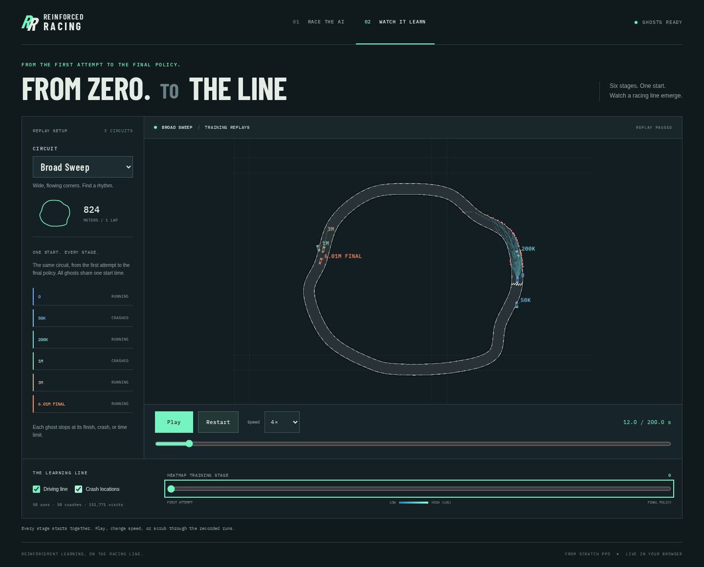
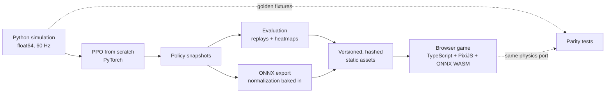

# Reinforced Racing

[](https://github.com/joeycatic/ReinforcedRacing/actions/workflows/ci.yml)

**A 2D racing game where you race a car that taught itself to drive, using PPO
implemented from scratch.**

### ▶ [Play it in your browser](https://joeycatic.github.io/ReinforcedRacing/)

No install, no backend. The AI opponent is a neural network that runs in your browser.



- **Race the AI.** Drive against a live policy network that runs ONNX inference
  at 30 Hz in WebAssembly. Pick an opponent from any training stage, from
  "can't find the throttle" to the final policy.
- **Watch it learn.** Six snapshots from 0 to 6M steps start together as ghosts.
  Heatmaps show where each stage drives and where it crashes, aggregated over
  50 runs per stage.
- **No RL library.** I wrote the PPO, GAE, observation/reward normalization,
  curriculum and the vectorized simulator myself in PyTorch and NumPy, then
  checked the browser port against the Python physics to 1e-12.

## Results


The final policy (seed 2, about 6M agent steps, roughly 10 minutes of training on
an RTX 3060 Ti):

| Evaluation | Result |
| --- | --- |
| Lap completion, 3 showcase tracks × 50 stochastic runs | **148/150 (98.7%)** |
| Lap completion, **50 tracks never seen in training** × 5 runs | **213/250 (85.2%)** |
| Python ↔ TypeScript physics and observation error over 600 ticks | **≤ 5.4e-13** |
| ONNX ↔ PyTorch policy output error | **≤ 1.9e-6** |
| Browser lap time vs Python reference, all three tracks | **within 1%** |
| Batched simulator throughput (64 cars, i5-11400F) | **13.8k steps/s** |

A second training seed reached 98.0% on the showcase tracks and 93.2% on the
held-out tracks, but it regressed on one track under its deterministic mean
action, so seed 2 ships. Both runs, including the failures, are recorded in
[experiments/M3_RESULTS.md](experiments/M3_RESULTS.md).

## How it works



**Simulation.** A dynamic bicycle model with tire slip runs at 60 Hz. Tracks
are generated from seeds. The car sees 9 raycast distances, its velocity, yaw
rate, heading error and lateral offset, and curvature samples of the track ahead
(22 values in total). The full layout is in
[sim/OBSERVATION.md](sim/OBSERVATION.md).

**Reward.** The car is rewarded for progress along the centerline, with a time
penalty, a crash penalty and a lap bonus. All weights are in
[configs/reward.yaml](configs/reward.yaml).

**Training.** PPO uses separate 256×256 actor and critic networks, a Gaussian
policy with a learned log-std, clipped surrogate and value losses, GAE (λ=0.95),
running observation and return normalization, and correct bootstrapping when an
episode is truncated by the time limit rather than ended by a crash. A curriculum
trains on one track until the car laps it reliably, then moves to a pool of 200
generated tracks. 64 environments run in a batched NumPy simulator. Code:
[train/ppo.py](train/ppo.py).

**Browser.** The simulation is ported to TypeScript in float64, and golden
fixtures from Python keep the two in sync. The exported ONNX model takes raw
observations, because the frozen normalizers are baked into the graph. Rendering
interpolates between fixed physics ticks, so the frame rate never affects the
simulation.

| Path | What's there |
| --- | --- |
| `sim/` | Physics, tracks, raycasts, rewards, Gymnasium and batched envs |
| `train/` | PPO, curriculum, checkpoints, TensorBoard logging |
| `eval/`, `export/` | Evaluation, replay/heatmap recording, ONNX and asset packaging |
| `web/src/sim/` | TypeScript port of the simulation |
| `web/src/race/`, `web/src/viewer/` | Live race, input, camera; ghost playback and heatmaps |
| `configs/` | Every physics, reward, PPO and export parameter |

## Run it locally

Requires Python 3.11+ with [uv](https://docs.astral.sh/uv/), and Node.js 22.12+.

```sh
make setup       # install locked Python and npm dependencies
make web-dev     # play locally; the trained models are already in web/public/assets
make test        # Ruff, pytest, strict TypeScript, Vitest
```

To train your own policy from scratch and replace the shipped models:

```sh
make train  ARGS="--run-dir artifacts/training/my-run"
make export ARGS="--run-dir artifacts/training/my-run"
```

Use `make drive` to drive the Python simulation yourself in a debug view.
Training, evaluation, export, the browser end-to-end tests and deployment are
covered in [docs/DEVELOPMENT.md](docs/DEVELOPMENT.md). Design decisions are
logged in [DECISIONS.md](DECISIONS.md).

## Controls

| Input | Action |
| --- | --- |
| WASD / arrow keys | Steer, accelerate, brake/reverse |
| Space | Brake |
| R | Back to the last checkpoint |
| Enter | Restart |
| Esc | Pause |
| Gamepad | Left stick steers, triggers accelerate/brake |

## Limitations

- You need a keyboard or gamepad to drive. On phones you can still use
  **Watch it learn**.
- Cars pass through each other; there is no car-to-car collision.
- Races are a single lap on three showcase tracks.

## License

[MIT](LICENSE)
