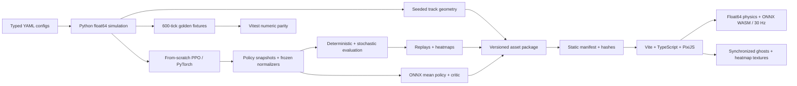

# Reinforced Racing

A 2D racing game where a car learns to drive through a **PPO implementation written
from scratch**. Race its live policy in your browser, compare ghosts from six stages
of training, and inspect where stochastic policies drive and crash. Everything runs
locally or as a static site; the game has no backend, accounts, or external art assets.


## Run it

Requires Python 3.11+ (3.12 is the default), [uv](https://docs.astral.sh/uv/), and
Node.js 22.12+ with npm. The first setup installs both locked dependency sets.

```sh
make setup
make export       # use the retained reference checkpoints, if present
make web-dev      # open the localhost URL printed by Vite
```

**Checkpoints and generated assets are not stored in Git.** This workspace's reference
run is `artifacts/training/m3-seed2`, selected in `configs/export.yaml`. On a fresh
checkout, train a complete run before exporting:

```sh
make train ARGS="--run-dir artifacts/training/my-run"
make export ARGS="--run-dir artifacts/training/my-run"
make web-dev
```

Training is actual PPO optimization, not a download or placeholder; it needs a
suitable CPU/GPU and learning results depend on the seed and training schedule.
The measured reference used seed 2, a 3M-step baseline, then continuation to 6M.
Use [the reproduction commands](docs/DEVELOPMENT.md#evaluate-policies) and
[experiment notes](experiments/M3_RESULTS.md) to reproduce that schedule.

For the standalone Python driving/debug view, use `make drive`. All simulation,
reward, training and export tuning lives in `configs/*.yaml`.

## Race the AI

Choose a circuit and opponent snapshot, then **Take the wheel**. The orange car runs
ONNX inference every two physics ticks; it is a live simulation. Mint is your car.
There is a countdown, one-lap timer, checkpoint splits against the AI, smooth follow
camera, speed zoom, minimap, finish result and rematch. Cars pass through each other.
The optional reference ghost is a separate recorded overlay.

| Controls | Action |
| --- | --- |
| WASD / arrows | Steer, accelerate, brake/reverse |
| Space | Brake/reverse |
| R | Return to the last checkpoint; lap time keeps running |
| Enter | Restart with a fresh countdown |
| Escape | Pause / resume; lap time stops |
| Standard gamepad | Left stick steers; right/left triggers accelerate/brake |

Small screens have a responsive layout and require a keyboard or gamepad. Held keys
clear on window blur; hiding the browser tab pauses the race/playback. Switching to
ghosts pauses your race; returning to the same circuit/opponent preserves it. Early snapshots
can stall or crash because they have not learned to drive yet.

**AI vision** draws the last nine sensor rays and displays steering, throttle/brake,
and the critic's expected-return estimate. The value uses training reward units;
it is not a lap-time estimate or win probability. Its display meter uses tanh(value/10);
the adjacent number is the raw output. Tire marks appear during lateral
slip, with a bounded, lightweight drift-particle effect disabled for reduced motion.

## Watch it learn

**Watch it learn** starts every recorded snapshot at the same start time. Blue marks
early policies, green the middle stages, and orange the final policy. Each car is
labeled with its training count. Play/pause, 0.5× / 1× / 2× / 4× speed, restart and a
scrubber share one playback clock. Each ghost holds its last pose when it finishes,
crashes, or reaches the time limit; its outcome stays visible in the stage legend.
The initial 0-step ghost lasts 200 seconds, so seeking is useful for later comparisons.

In either view, toggle **Driving line** and **Crash locations**, then move the
**Heatmap training stage** slider. These layers aggregate **50 stochastic trials**
per showcase/stage; the ghosts are separate deterministic mean-policy runs.
Visitation uses exact 0.5 m cells. Crash density and actual crash points use red.
Log intensity is normalized against one peak across all snapshots of that track,
so the slider remains comparable; each track gets its own scale. Empty crash layers
are transparent and explicitly report zero crashes. The selected heatmap stage is
independent of the live opponent and replay time. It does not load another model.

## How it works



Physics advances at 60 Hz; controls update at 30 Hz. Rendering uses an accumulator
and interpolation, while camera effects never affect simulation. Long stalls cap
catch-up instead of changing dt. Python and TypeScript share physics/track/observation
version identifiers, and browser loaders reject incompatible versions and verify
asset hashes. ONNX embeds frozen observation normalization and accepts raw float64
`obs.v1` vectors, returning float32 mean controls and critic values.

| Location | Purpose |
| --- | --- |
| `sim/`, `web/src/sim/` | Authoritative Python simulation and float64 browser port |
| `train/ppo.py`, `configs/ppo.yaml` | PPO, logging, curriculum, checkpoints and snapshots |
| `eval/`, `export/` | Trial recording, heatmap aggregation, ONNX and asset packaging |
| `web/src/race/` | Live race, input, policy inference, camera and PixiJS scene |
| `web/src/viewer/` | Shared replay clock, stage labels, heatmap rasterization/control |
| `tests/fixtures/parity/`, `web/tests/`, `web/e2e/` | Golden, unit and real-browser checks |

Detailed contracts are in [observation layout](sim/OBSERVATION.md),
[asset formats and parity](docs/ASSETS.md), and [development reference](docs/DEVELOPMENT.md).
Ambiguity resolutions and milestone boundaries are recorded in [DECISIONS.md](DECISIONS.md).

## Measured results

Reference policy: seed 2, **6,012,928** agent steps, trained on the configured 200-track
pool after its single-track curriculum. Held-out tracks were excluded from training.

| Evaluation | Result |
| --- | --- |
| Showcase completion, 50 stochastic trials × 3 tracks | **148/150 — 98.7%** |
| Held-out completion, 5 trials × 50 tracks | **213/250 — 85.2%** |
| Measured training rollout/update time | **9.81 min**, RTX 3060 Ti |
| Native 64-car environment throughput | **13,755 agent steps/s**, i5-11400F |
| Python/TypeScript golden state + observation error | **≤5.41e-13**, required ≤1e-6 |
| ONNX/PyTorch maximum output error | **≤1.91e-6**, required ≤1e-5 |

| Deterministic showcase lap | Python | Live browser WASM | Difference |
| --- | ---: | ---: | ---: |
| Broad Sweep | 24.246155 s | 24.225082 s | 0.0869% |
| Long Ribbon | 24.591262 s | 24.652338 s | 0.2484% |
| Technical Loop | 19.812376 s | 19.621723 s | 0.9623% |

All browser lap differences are below the required 2%. Closed-loop paths are not
bit-identical; see [M5 validation](docs/M5_RESULTS.md) for trajectory diagnostics and
measurement conditions. The M5 software-rendered Chromium test sustained about
60 FPS at 1440×1050 with a 16.7–16.8 ms p95 frame interval. M6 measured **59.60 FPS /
16.70 ms p95** with both heatmaps and AI vision enabled; its overlay/production
checks are recorded in [M6 validation](docs/M6_RESULTS.md). These are host measurements,
not an assertion about untested laptop hardware.

Training time excludes startup, geometry, evaluation and checkpoint writes. A fresh
6M run has a different learning-rate history from the measured 3M→6M continuation.
Full evidence: [training results](experiments/M3_RESULTS.md),
[benchmark](docs/m2-benchmark.json), [export validation](docs/m4-validation.json),
[browser results](docs/m5-browser-results.json).

## Verify and build

```sh
make test                                      # Ruff, pytest, strict TS, Vitest
make parity                                    # regenerate Python golden fixtures
make eval                                      # all snapshots, showcase + held-out
make web-build                                 # self-contained web/dist/
npm run --prefix web preview                    # inspect the production build
# Install the browser once for acceptance checks:
cd web && npx playwright install chromium
npm run test:e2e                                # live WASM, controls, playback, overlays
npm run test:static                             # build + repository-prefix static check
```

The browser suites need a complete export. The Python/TS unit suites can run on a
clean checkout; the existing full-bundle integrity test skips until assets exist.
Simulation behavior is unchanged through M6; physics, observation and track versions
remain v1. PyTorch emits a deprecation notice for the explicit TorchScript ONNX
exporter; its outputs are checked against ONNX Runtime before packaging.

## Deploy to GitHub Pages

Run `make web-build` and publish the **contents of `web/dist/`** as the site root.
The output includes all models, replays, heatmaps, fonts and WASM; no application
server, CDN or isolation headers are needed. Relative Vite paths support both
`https://user.github.io/` and `https://user.github.io/repository/` without changing
source. `.nojekyll` is included for branch-based publication.

For branch publication, put the compiled files in the chosen publishing branch's
root and select that branch/root in repository **Settings → Pages**. For Actions,
upload the prepared directory using `actions/upload-pages-artifact` and deploy with
`actions/deploy-pages`; preserve the generated export when preparing that artifact.
See GitHub's [publishing-source instructions](https://docs.github.com/en/pages/getting-started-with-github-pages/configuring-a-publishing-source-for-your-github-pages-site)
and [static-site / .nojekyll guidance](https://docs.github.com/en/pages/getting-started-with-github-pages/creating-a-github-pages-site).
The repository intentionally does not auto-deploy or train on push: model artifacts
are generated locally and excluded from Git. No changes to source files are required
to host the resulting `dist` directory.

## GIF recording placeholders

These slots intentionally await real recordings; no GIF footage is fabricated.

| Slot | Save as | What to record |
| --- | --- | --- |
| Live race | `docs/media/race.gif` | Countdown, a corner with the orange AI, and a split |
| Learning time-lapse | `docs/media/ghosts.gif` | Watch it learn at 2×, from a common start to diverging lines |
| Heatmap evolution | `docs/media/heatmaps.gif` | Pause the ghosts, enable both layers, slide from 0 to final |

Start `make web-dev`, use your OS/browser screen recorder for a 5–8 second clip,
and save the capture as `recording.webm` (or substitute your captured video format).
Keep the circuit and relevant controls visible; avoid cropping away the stage label.
If ffmpeg is available, convert the recording with:

```sh
mkdir -p docs/media
ffmpeg -i recording.webm -vf 'fps=15,scale=960:-1:flags=lanczos,split[s0][s1];[s0]palettegen[p];[s1][p]paletteuse' -loop 0 docs/media/ghosts.gif
```

Replace the slot with a normal Markdown image when the real GIF is recorded.

## Scope and open checks

M1–M6 are implemented. This MVP deliberately excludes online racing, accounts, 3D,
a track editor, surfaces/boost pads and car-to-car collision. Physical gamepad use,
subjective keyboard feel, and performance on an actual mid-range laptop still need
human/hardware checks. Small screens require a keyboard or gamepad. The trained
reference artifacts must be retained or regenerated to rebuild the static bundle.
