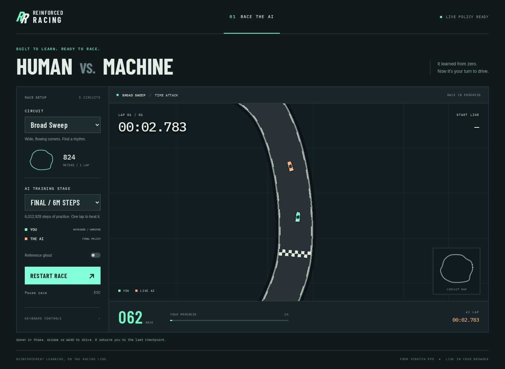

# Development reference

Detailed simulation, environment, training, and export notes retained from M1–M5.
For the complete app and deployment, start with [the main README](../README.md).

## Run

Install [uv](https://docs.astral.sh/uv/getting-started/installation/) and Node.js 22+
(with npm), then:

```sh
make setup
make drive
```

`uv` manages the Python environment and dependencies. The project defaults to Python 3.12;
uv can download it if needed. A desktop display is required for interactive driving.

| Input | Action |
| --- | --- |
| W / Up | Accelerate |
| S / Down / Space | Brake; reverse when nearly stopped |
| A / Left, D / Right | Steer left/right |
| R | Instantly respawn at the last checkpoint |
| Enter | Restart the session and timer |
| Escape | Quit |

Steering ramps in rather than snapping to full lock. Brake for tight bends; use short
steering presses at speed and countersteer if the rear slides. Crashes freeze the car
for 0.5 simulation seconds, then respawn with zero velocity. Lap timing includes this delay.
The first timer starts when the session opens; press Enter for a fresh attempt.

```sh
make drive ARGS="--showcase ribbon"       # sweep (default), ribbon, technical
make drive ARGS="--seed 42"              # reproducible generated track
make drive ARGS="--export-track artifacts/my.track.v1.json"
make drive ARGS="--track artifacts/my.track.v1.json"
make tracks                              # export all three showcases
make tracks ARGS="--seed 42 --output artifacts/custom"
```

Exports are written to `artifacts/tracks/` by default and are intentionally ignored by Git.
No server or external art assets are needed.

## Verify

```sh
make test
make drive ARGS="--headless --steps 600 --screenshot artifacts/m1-drive.png"
```

`make test` checks Ruff lint/format, pytest, TypeScript types and Vitest, including track rejection and
serialization, progress in both directions, interpolated lap timing, crash/respawn,
determinism, tire saturation and recovery, complete driven laps on all showcases,
and a headless pygame smoke check. The headless CLI uses scripted controls and SDL's
dummy video driver; it is suitable for CI and does not need a display.

With the default physics, a straight-line simulation reaches **100 km/h in 2.98 s**
and settles at **74.38 m/s**. These are simulation measurements, not wall-clock benchmarks.
The tests enforce the specification's acceleration/top-speed ranges. M2 checks also run
Gymnasium's environment checker, compare scalar and batched physics over 600 ticks,
compare grid rays against full-boundary intersections, and cover episode limits,
reward terms, deterministic track assignment, autoreset, and terminal observations.

## RL environments (M2)

```python
import numpy as np
from sim.env import RaceEnv
from sim.vec_env import VecRaceEnv
from sim.pool import make_track_pool

# Quick defaults use the three showcase tracks.
env = RaceEnv()
observation, info = env.reset(seed=42)
observation, reward, terminated, truncated, info = env.step(np.array([0.0, 1.0]))
if terminated or truncated:
    observation, info = env.reset()
env.close()

# Build static geometry/grid once, then simulate 64 cars in NumPy batches.
pool = make_track_pool("training")  # 200 generated tracks; held_out has 50 separate seeds.
envs = VecRaceEnv(64, pool)
observations, info = envs.reset(seed=42)
observations, rewards, terminated, truncated, info = envs.step(np.zeros((64, 2)))
envs.close()
```

Actions are `[steer, throttle]`; shapes are `(2,)` and `(N, 2)`. Observations are
float64 with shapes `(22,)` and `(N, 22)`. The exact `obs.v1` layout, normalization,
signs, and terminal-observation contract are in [sim/OBSERVATION.md](../sim/OBSERVATION.md).
The spec's listed components sum to 21; the 22nd value exposes the steering actuator.

Rewards sum four individually logged weighted terms from `configs/reward.yaml`:
`0.1 × delta_progress`, `−0.001` time pressure, `−10` crash, and `+5` per completed lap.
Crashes terminate; reaching two laps or 6000 agent steps truncates. Limits live in
`configs/env.yaml`. Info includes progress, lap count/timing, wrong-way status,
physics/agent step counts, episode return, and `reward_terms`; finished episodes also
include an `episode` summary and accumulated reward terms.

`RaceEnv` requires explicit reset after finishing. `VecRaceEnv` resets finished cars
immediately, drawing tracks uniformly from its pool. Returned observations for these
cars belong to the next episode. Use `info["final_obs"]` and `info["_final_obs"]` for
the previous episode's terminal observations; truncated transitions must bootstrap
from those terminal observations. Root info describes the transition just taken.
Always call `reset(seed=...)` before stepping. The same seed, ordered pool, batch size,
and actions reproduce track selection and transitions, including autoresets.

For fixed evaluation tracks, construct `TrackPool([track])`, or select the initial
track using `reset(options={"track_index": i})` on RaceEnv / `track_indices` on VecRaceEnv.
Environments are headless; use `make drive` for pygame keyboard driving.

## Throughput

```sh
make benchmark
make benchmark ARGS="--output artifacts/m2-benchmark.json"
```

The benchmark uses 64 cars, 64 generated training tracks, 100 warmup batches, and
three samples of 1000 batches. One agent step means **one car taking an action for
up to two physics ticks**, so a vector call contains 64 agent steps. Timing includes
physics, local projection, grid-based rays, observations, rewards, info, and same-step
autoreset. Pool generation/grid construction and action generation are excluded and
setup time is reported separately. Runtime controls are seeded and held for eight
agent steps, allowing cars to accelerate, crash, and exercise resets.

The recorded measurement on this host (Intel Core i5-11400F, Python 3.12.13, NumPy 2.5.4)
was **13,755 agent steps/s** (sample rates 13,819 / 13,755 / 13,709), above the 10,000
target. There were 711 / 714 / 729 autoresets; pool/grid setup took 11.11 s. Full results
are saved in [docs/m2-benchmark.json](../docs/m2-benchmark.json). This is a desktop CPU
measurement; performance on a particular laptop still needs measuring.

## Train PPO (M3)

```sh
make setup
make train
make train ARGS="--run-dir artifacts/training/my-run --device cpu"
make train ARGS="--run-dir artifacts/training/my-run --resume artifacts/training/my-run/latest.pt"
uv run tensorboard --logdir artifacts/training
```

`configs/ppo.yaml` contains all algorithm and curriculum settings. The default uses
64 cars × 256 steps, ten epochs/four minibatches, separate two-layer 256-unit tanh
actor/critic networks, Gaussian actions, a 6M-step budget, and Adam at 3e-4 with linear annealing.
Device auto-selection is CUDA → Apple MPS → CPU. Try `--device cpu`: CPU is usually
fastest for networks this small, though hardware and minibatch size affect results.

Training starts on the `sweep` showcase. Every ten updates an independent eight-run
stochastic evaluation checks the first lap. After at least 200k agent steps and ≥95%
success, training switches to the full 200-track pool. This transition preserves
the policy, optimizer, running statistics, and global step. A run that never passes
this gate remains on the single track; reaching its step budget does not mean M3's
learning criteria have been met.

`train/ppo.py` implements the clipped surrogate, optional clipped value loss, GAE,
minibatch advantage normalization, entropy bonus, and gradient norm clipping without
an RL framework. Actions are sampled from a Gaussian with learned state-independent
log standard deviation; likelihoods use the original samples and only the actions
sent to the environment are clipped. GAE bootstraps truncations from `final_obs`,
cuts recursion at every episode boundary, and never bootstraps a crash.

Running mean/variance normalizes observations. Rewards are divided by the standard
deviation of discounted returns, without subtracting a reward mean. Evaluation freezes
statistics and reports original, unscaled episode rewards. TensorBoard and JSONL
logs include episode returns/laps, best lap time, crash rate, reward terms, policy/value
losses, entropy/log_std, KL, clip fraction, explained variance, throughput, observation
ranges, and action clipping. The simulation remains float64; the networks use float32.

Checkpoints are atomic writes under the run directory. `latest.pt` and numbered
`checkpoints/` files contain model/Adam state, observation/return statistics, RNG states,
live vector-environment state, versions, and configuration. Resume rejects changed
geometry or simulation settings. Exact uninterrupted-vs-resumed training is tested
on CPU and on CUDA when available. To increase a run's budget, add `--total-timesteps`;
that extends the linear learning-rate horizon and is a deliberate continuation change.
`--updates 3` stops after three additional updates and writes a resumable checkpoint.

Scheduled policy snapshots are stored in `snapshots/` for steps 0, 50k, 200k, 1M, 3M,
and `final`. They include both normalizers and are intentionally separate from resumable
checkpoints. A threshold is captured at the first vector batch that reaches it (50k is
captured at 50,048 with 64 cars); metadata records both requested and actual step counts.
The policy stays fixed during a rollout, while its observation statistics continue to
update. Full training stops at a rollout boundary and can slightly exceed the budget.

## Evaluate policies

```sh
make eval                                # M4: all snapshots, replays and heatmaps
make eval ARGS="--run-dir artifacts/training/my-run"
make eval ARGS="--checkpoint artifacts/training/my-run/latest.pt --runs 5"
make eval ARGS="--checkpoint artifacts/training/my-run/latest.pt --deterministic --runs 1"
make eval ARGS="--checkpoint artifacts/training/my-run/latest.pt --snapshots --runs 5"
```

The M3 evaluator prints lap completion, crash rate, and mean/best lap time per snapshot
for the three showcases and 50 held-out tracks, with per-track/per-episode JSON results
in `artifacts/evaluation/`. `--runs` is the number of trials **per track**. Default trials
sample the Gaussian policy; `--deterministic` uses its mean, as the eventual browser
opponent will. Each trial starts from rest at the start line and stops at its first
completed lap, crash, or the configured step limit. It never trains on held-out tracks
or updates running statistics. A timeout counts as an unsuccessful lap; lap times only
summarize successful trials. The default M4 pipeline also records deterministic ghosts and stochastic heatmaps; explicit `--checkpoint` commands retain the summary-only evaluator.

The measured reference runs started with the saved 3M-step baseline configurations
and resumed to 6M after diagnosing insufficient training on the larger pool. To
reproduce that exact schedule (rather than a fresh run with a 6M annealing horizon):

```sh
make train ARGS="--config experiments/m3-baseline-seed1.yaml --run-dir artifacts/training/reproduce-seed1"
make train ARGS="--run-dir artifacts/training/reproduce-seed1 --resume artifacts/training/reproduce-seed1/latest.pt --total-timesteps 6000000"
```

Use `m3-baseline-seed2.yaml` and a separate directory for the second seed. See
[experiments/m3-diagnosis.json](../experiments/m3-diagnosis.json) for the signal checks
and the one-setting budget change. The default budget was raised to 6M after this
comparison; learning results remain something to measure, not assume from finite losses.

The validated reference is `artifacts/training/m3-seed2/latest.pt` (6,012,928 steps):
**98.7% showcase completion** over 150 stochastic trials and **85.2% held-out completion**
over 250 trials, exceeding M3's 95% / 80% targets. Mean-action evaluation completes all
three showcases and 43/50 held-out tracks. Measured rollout/update time was **9.81 min**
on an RTX 3060 Ti; startup, pool generation and evaluation are excluded. Seed 1 also
passes the stochastic targets but has a deterministic technical-track regression,
so seed 2 is the reference for future browser work.

See [experiments/M3_RESULTS.md](../experiments/M3_RESULTS.md) for both seeds, per-track
lap times, failure counts, experiment conditions, hashes, and raw results. To inspect
the retained reference directly:

```sh
make eval ARGS="--checkpoint artifacts/training/m3-seed2/latest.pt --showcase-only --runs 50"
make eval ARGS="--checkpoint artifacts/training/m3-seed2/latest.pt --runs 5"
```

## Export models and browser data (M4)

Requires Node.js 22+ and npm in addition to Python/uv. `make setup` installs both
locked dependency sets. The default source is the retained, validated seed-2 run;
for a clean checkout, train a complete run first and pass its directory.

```sh
make setup
make eval                                # all six snapshots; can take several minutes
make export                              # verified cache reuse, ONNX + static bundle
make export ARGS="--run-dir artifacts/training/my-run"
make parity                              # regenerate committed Python truth fixtures
make test                                # Python + TypeScript parity and asset checks
```

Export produces `web/public/assets/manifest.json`, simulation settings, three tracks,
six ONNX policies, 18 quantized/delta ghosts, and 18 sparse heatmaps (50 stochastic
runs each). Every asset has a size/hash descriptor, and the loader rejects incompatible
physics/obs/track/replay/heatmap versions before fetching dependent files. The bundle
is self-contained. The exported bundle for the reference run is committed so a fresh
clone can play and deploy; checkpoints and evaluations stay ignored, so preserve the
training checkpoints to rebuild them. The race interface uses this bundle directly.

ONNX accepts raw float64 `[batch,22]` observations and includes frozen normalization.
It returns float32 policy means and critic values. Export checks both against PyTorch
at ≤1e-5, including single-car batches. Each showcase fixture tests 600 ticks of
float64 TypeScript physics/observations and integrated crash/respawn sessions at ≤1e-6.
See [docs/ASSETS.md](../docs/ASSETS.md) for schemas, replay decoding, heatmap conventions,
cache integrity, parity coverage and limitations.

## Race the live AI (M5)



```sh
make web-dev                       # localhost Vite server; requires make export first
make web-build                     # static site in web/dist/
cd web && npm run test:e2e          # requires npx playwright install chromium once
```

Choose a circuit and opponent stage, then take the wheel. Arrow keys/WASD drive;
Space brakes/reverses, R respawns, Enter restarts, and Escape pauses. Standard gamepad
stick/triggers are supported. The AI runs its ONNX policy every two physics ticks;
the optional reference ghost is an independent overlay. Countdown, checkpoint splits,
follow camera, minimap, first-lap results and rematches are included.

The live browser final policy completes all showcases with lap times **0.087% / 0.248% /
0.962%** from Python evaluation (required: ≤2%). The measured software-rendered Chromium
sample sustained **60 FPS**, p95 **16.8 ms**, on this desktop host. See
[docs/M5_RESULTS.md](../docs/M5_RESULTS.md) for conditions, commands, timings and limits.

## Code and data

| Location | Responsibility |
| --- | --- |
| `sim/config.py`, `configs/*.yaml` | Validated dataclasses and all simulation tuning |
| `sim/physics.py` | Tire forces, steering actuator, longitudinal forces, fixed-step integration |
| `sim/geometry.py`, `sim/track.py` | Seeded spline tracks, resampling, validation, JSON |
| `sim/progress.py` | Local projection, signed offset, unwrapped progress, checkpoints/laps |
| `sim/session.py` | Play/training crash behavior and deterministic session clock |
| `sim/pool.py`, `sim/raycast.py` | Shared static geometry and batched grid traversal |
| `sim/observation.py`, `sim/reward.py` | Versioned observations and weighted reward terms |
| `sim/env.py`, `sim/vec_env.py` | Scalar Gymnasium and native batched environments |
| `tools/debug_drive.py` | Keyboard controls and pygame rendering |
| `tools/export_tracks.py` | Track-only JSON export |
| `tools/benchmark.py` | Full-transition CPU throughput measurement |
| `train/config.py`, `configs/ppo.yaml` | Typed PPO, normalization, curriculum and snapshot settings |
| `train/ppo.py` | Single-file PPO, logging, checkpoint/resume and curriculum loop |
| `eval/evaluate.py`, `eval/artifacts.py` | Frozen-policy evaluation and verified snapshot pipeline |
| `eval/record.py`, `eval/formats.py` | Per-tick recording, quantized ghosts and sparse heatmaps |
| `export/onnx.py`, `export/assets.py` | Normalized ONNX policy graphs and versioned static packaging |
| `web/src/sim/`, `web/src/assets/` | Float64 browser simulation and strict asset loaders |
| `web/src/race/`, `web/src/main.ts` | Live race engine, WASM policy, PixiJS scene, input and interface |
| `tools/generate_parity.py`, `tests/fixtures/parity/` | Python truth for 600-tick Vitest parity checks |

Simulation uses SI units, positive-left steering and a y-up world. Physics advances at
1/60 s with semi-implicit Euler; controls update every two ticks. Rendering and wall
time never enter the simulation. The model uses front/rear linear slip forces clamped
at separate friction limits, speed-dependent engine/steering, drag, rolling resistance,
and low-speed reverse. `CarState.steering` holds the actuator's normalized input.
Current physics version: `physics.v1`.

Track files declare `version: "track.v1"` and contain `id`, `name`, `seed`, `width`,
`centerline`, `arc_length`, `tangents`, `curvature`, `left`, `right`, and `checkpoints`.
Closed polylines have N points with no duplicate final point; `arc_length` has N+1
entries including the closing segment. Checkpoints are arc lengths at 25 m intervals,
starting at zero. Sampling wraps across the finish. JSON loading checks the version,
finite geometry, derived arrays, and track validity, preserving exported numbers.
The browser loads this geometry directly instead of regenerating it.

## Learning-curve figure

`docs/images/learning-curve.svg` is generated from the reference run's
`metrics.jsonl` and the M4 snapshot evaluation summary:

```sh
uv run --locked python -m tools.plot_learning
```

## Deploy

Pushing to `main` starts CI. Only successful CI for the exact current main SHA
authorizes Pages to build from committed assets and publish. See [CI and Pages
release](#ci-and-pages-release) below for functional checks and manual dispatch gates.
Enable Pages under **Settings → Pages → Source: GitHub Actions**. Vite uses relative
paths for repository subpaths. Training/export never run in CI; regenerate and commit
`web/public/assets/` locally to ship a new policy.

## Recording demo GIFs

Run `make web-dev`, record a 5–8 second clip with your OS or browser screen recorder,
and convert it with ffmpeg:

```sh
mkdir -p docs/media
ffmpeg -i recording.webm -vf 'fps=15,scale=960:-1:flags=lanczos,split[s0][s1];[s0]palettegen[p];[s1][p]paletteuse' -loop 0 docs/media/race.gif
```

Good clips: the countdown and a corner against the orange AI (`race.gif`), and
**Watch it learn** progressing through attempts and leaving faded trails (`watch.gif`).

## Current status

The complete M1–M6 application is described in [the main README](../README.md).
Physical gamepad/laptop checks and human keyboard playtesting remain outside the
automated results.

## M7: Stadium intro and medals

Run `make web-dev`, open `/` for the intro, `/race.html` for the race, or
`/watch.html` for progressive training replays (M8). `/race.html#watch` redirects there.
`make web-build` builds all four HTML entry points (`index.html`, `race.html`,
`watch.html`, `editor.html`), suitable for a static host without SPA route rewriting.

`make medals` evaluates the 36 retained seed-2 checkpoints without retraining and writes
`configs/medals.yaml` plus `experiments/medal-selection.json`. `make export` verifies
selected checkpoint hashes, exports medal models/replays, builds source-backed site and
parity data, and atomically replaces the committed manifest.v3 bundle. Retained logs for
both seeds are needed for export, but no training artifacts are needed to run the site
or normal CI. Only Gold and Author meet the per-track 3% separation requirement.

Verification: `make test`, then `npm run --prefix web test:e2e`,
`npm run --prefix web test:static`, and `make web-build`. The source-regeneration test
skips in a fresh CI checkout without retained training logs; the committed data and
asset hashes are still tested there. Browser captures are saved in `web/test-results/`.

The hero pauses off screen and when the tab is hidden. Reduced motion shows a static
circuit, and model/WASM failures leave the intro content and static preview usable.
The parity demo compares the fixture's unrestricted physics path with the unchanged
TypeScript kernel; crash/respawn and observation parity remain covered by the original
600-tick fixtures.

## M8: Progressive Watch it learn

```sh
make attempts   # select deterministic attempts from retained seed-2 snapshots/checkpoints
make export     # verify selected checkpoint hashes and package manifest.v3 assets
make web-dev    # open /watch.html
```

`make attempts` writes `configs/attempts.yaml` and `experiments/attempt-selection.json`.
It requires the retained `artifacts/training/m3-seed2` run, not retraining. Selection
keeps a strict improvement chain, thinned to at most ten attempts while preserving
the first run, first finisher and final policy. The shipped counts are Sweep 10,
Ribbon 7 and Technical 9. Regeneration resets curated headlines: inspect the replays
before restoring descriptive headlines. `make export` adds only selected attempt
replays, without new ONNX models; existing physics/observation/track/replay/heatmap
versions are unchanged. The committed bundle runs without training artifacts.

The timeline targets 60 seconds using capped replay compression, a 1.5-second
endpoint hold, a three-second stall cut and a final lap at 2×. Training-progress
segments support jumps in either direction; only preceding attempts leave trails.
Crash locations are off by default and show the nearest snapshot at or below the
attempt's actual training step, labelled with that stochastic stage and run count.
Reduced motion starts paused and explicit playback stops after the selected attempt;
hidden tabs pause without automatically resuming. Failed replay loads leave the
track picker usable.

Final verification commands (use a free E2E_PORT if 5173 is occupied):

```sh
make test
make web-build
E2E_PORT=5181 npm run test:e2e --prefix web
npm run test:static --prefix web
```

The static suite serves the built four-page site under a repository subpath and
checks that asset requests stay local. Runtime timing evidence and selection/pacing
decisions are recorded in [DECISIONS.md](../DECISIONS.md#m8-decisions).

## M9: editor fixtures and local verification

Open `/editor.html` with `make web-dev`. `configs/editor.yaml` is authoritative;
`web/src/editor/editor-config.json` matches it and adds capture settings.
`tests/fixtures/editor/` covers loop, figure8, pretzel, fold, overlap, shallow,
near-start and tight drawings; `tests/fixtures/crossing/figure8.json` covers
branch-aware observations and controls. `make parity` regenerates both sets and
the three original showcase fixtures. Always verify the originals stay byte-identical:

```sh
make parity
git diff --exit-code tests/fixtures/parity/{sweep,ribbon,technical}.json
make test
make web-build
E2E_PORT=5181 npm run test:e2e --prefix web
npm run test:static --prefix web
```

The full local browser suite retains the strict render benchmark and figure-eight
lap assertion. M9 acceptance is pending: raw policy figure8 crashes near 313 m;
its valid overpass does not itself guarantee a successful lap. No M9 export or
training command is needed. Live AI vision uses current observations; custom
tracks have no exported ghosts, reference medal times or heatmaps.

## CI and Pages release

[CI](https://github.com/joeycatic/ReinforcedRacing/actions/workflows/ci.yml) runs
locked setup, unit/type checks, build, Chromium functional browser checks and the
repository-prefix static suite for main pushes, pull requests and manual dispatch.
Shared hosted CI excludes only `render frame timing during live inference`:
software rendering and shared CPU scheduling are hardware-dependent (one contended
local run measured p95 33.3 ms; an isolated run measured about 60 FPS / 16.7 ms).
The unchanged strict threshold remains required in the full local suite above.
All functional tests, including figure8 acceptance, remain enabled in CI.

After final local acceptance, push main and inspect its successful CI run.
[Pages](https://github.com/joeycatic/ReinforcedRacing/actions/workflows/pages.yml)
automatically builds that exact successful push SHA. It accepts only this repository's
main push runs, checks the SHA is still main's head before building and publishing,
and serializes releases. Manual Pages dispatch is main-only and requires a
successful push CI run for the exact current main SHA too. Failed/pending CI, PR/fork
runs and stale commits cannot authorize a release. A newer main can make an older
release ineligible; wait for that newer SHA's CI. Enable Pages with GitHub Actions
as its source. After deployment verify the Pages URL and smoke-test all four pages.
Training/export never run in CI; committed public assets supply the site.
